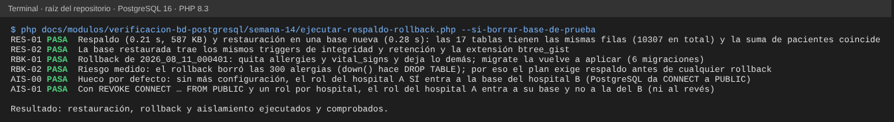
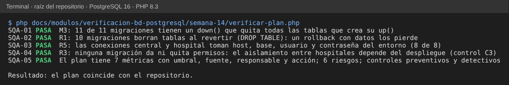

# Semana 14 — Plan de aseguramiento de calidad de la base de datos

**Estudiante:** Joshua Eduardo García Reyes (`jgarciar73-svg`) · **Módulo:** Verificación de base de datos PostgreSQL (asignado en el tablero del docente)

**Tarea:** definir el plan de aseguramiento de calidad de la base de datos: respaldo y restauración, rollback de migraciones, aislamiento entre hospitales y métricas. **Entregable:** plan SQA con evidencia de **una restauración y un rollback ejecutados** (§6).

**Alcance:** bases CENTRAL y HOSPITAL (una por hospital) de PostgreSQL 16, sus 11 migraciones y su despliegue. No cubre la calidad del código de cada módulo.

## 1. Métricas

| ID | Métrica | Umbral | Fuente | Responsable | Acción si no se cumple |
|---|---|---|---|---|---|
| M1 | Pérdida máxima de datos (RPO) | ≤ 15 min | Respaldo diario `pg_dump -Fc` + archivado de WAL; hora del último WAL archivado | Administrador de BD | Revisar el archivado ese mismo día; si falla 2 veces, respaldo manual y aviso al líder |
| M2 | Tiempo de restauración (RTO) | ≤ 1 h por hospital | Restauración de prueba mensual (§6, RES-01) | Administrador de BD | Si se pasa, restaurar en paralelo por hospital y revisar el tamaño del respaldo |
| M3 | Migraciones con `down()` que deshace todo lo que crea `up()` | 100 % | `verificar-plan.php` (SQA-01); hoy 11 de 11 | Autor de cada migración | No se fusiona el PR hasta completar el `down()` |
| M4 | Rollbacks ensayados antes de producción | 100 % de las migraciones nuevas | `migrate` + `migrate:rollback` en la base de prueba (§6, RBK-01) y la suite del grupo | Autor de la migración y revisor del PR | El revisor rechaza el PR |
| M5 | Roles de aplicación que pueden entrar a la base de otro hospital | 0 | Consulta de `has_database_privilege` por rol (§6, AIS-01) | Administrador de BD | Quitar el permiso el mismo día y revisar qué se consultó |
| M6 | Accesos entre hospitales con permiso y auditoría | 100 % | `cross_hospital_access_grants` contra `cross_hospital_access_audits` (CENTRAL) | Oficial de seguridad | Revisar cada acceso sin permiso; «break glass» se revisa en `break_glass_reviews` |
| M7 | Pruebas de integridad del grupo que pasan (`phpunit --testsuite Database`) | 100 % | CI o ejecución local antes de cada PR | Líder del grupo | No se fusiona; AU-06 (semana 7) primero |

## 2. Matriz de riesgos

| ID | Riesgo | Probabilidad | Impacto | Evidencia | Control |
|---|---|---|---|---|---|
| R1 | Un rollback borra datos: los `down()` hacen `DROP TABLE` | Media | Alto | RBK-02: el rollback borró 300 alergias | C1, C4 |
| R2 | Un respaldo que nunca se probó no restaura (o restaura sin triggers ni extensiones) | Media | Alto | RES-01, RES-02 | C2 |
| R3 | El rol de un hospital entra a la base de otro: PostgreSQL da `CONNECT` a `PUBLIC` por defecto | Alta | Alto | AIS-00 | C3 |
| R4 | Una migración nueva rompe pruebas aunque no cambie lo que prueban (`--step` fijo) | Alta | Medio | AU-06 (semana 7) | C5 |
| R5 | Credenciales en el código o en el repositorio | Baja | Alto | SQA-02: `config/database.php` las lee del entorno | C6 |
| R6 | Se aplica en producción una migración sin revisar | Media | Alto | Semana 13: acta de revisión | C5 |

## 3. Controles

| ID | Tipo | Control | Riesgo |
|---|---|---|---|
| C1 | Preventivo | Antes de cualquier rollback en una base con datos: respaldo y confirmación por escrito de qué tablas se borran | R1 |
| C2 | Detectivo | Restauración de prueba mensual en una base nueva, comparando filas y sumas (como RES-01) | R2 |
| C3 | Preventivo | `REVOKE CONNECT ON DATABASE … FROM PUBLIC` y un rol de aplicación por hospital con `GRANT CONNECT` solo a su base (AIS-01) | R3 |
| C4 | Preventivo | Las migraciones que borran datos al revertir lo dicen en un comentario y en el PR | R1 |
| C5 | Preventivo | Revisión técnica (semana 13) y suite de integridad antes de fusionar; pruebas de rollback por nombre de migración | R4, R6 |
| C6 | Detectivo | Búsqueda de contraseñas en el diff de cada PR; `.env` fuera del repositorio | R5 |

## 4. Procedimientos

```bash
# Respaldo (por hospital; la contraseña va en PGPASSWORD o ~/.pgpass, nunca en el comando guardado)
pg_dump -Fc -h $HOSPITAL_DB_HOST -U $HOSPITAL_DB_USERNAME -f hospital-AAAAMMDD.dump $HOSPITAL_DB_DATABASE
# Restauración en una base nueva y comparación antes de cambiar la aplicación a ella
createdb hospital_restaurada && pg_restore --no-owner -d hospital_restaurada hospital-AAAAMMDD.dump
# Rollback de la última migración de HOSPITAL (solo después de C1)
php artisan migrate:rollback --database=hospital --path=database/migrations/hospital --step=1
```

## 5. Calendario de seguimiento

| Frecuencia | Qué | Quién |
|---|---|---|
| Diario | M1: revisar respaldo y archivado de WAL | Administrador de BD |
| Cada PR con migración | M3, M4, M7 y revisión técnica | Autor y revisor |
| Semanal | M6: accesos entre hospitales y revisiones de «break glass» | Oficial de seguridad |
| Mensual | M2 (restauración de prueba) y M5 (permisos por rol) | Administrador de BD |
| Cada parcial | Informe de métricas al docente | Este módulo |

## 6. Evidencia ejecutada

```bash
php docs/modulos/verificacion-bd-postgresql/semana-14/verificar-plan.php      # solo PHP
php docs/modulos/verificacion-bd-postgresql/semana-14/ejecutar-respaldo-rollback.php --si-borrar-base-de-prueba   # PostgreSQL de prueba, pg_dump/pg_restore y composer install
```

**Restauración y rollback ejecutados** en PostgreSQL 16 con las migraciones reales de HOSPITAL y 5 000 pacientes de prueba: respaldo con `pg_dump`, restauración en una base nueva con las mismas filas, triggers y extensión; rollback de la última migración y vuelta a aplicarla; y aislamiento entre dos hospitales antes y después de `REVOKE CONNECT`.




