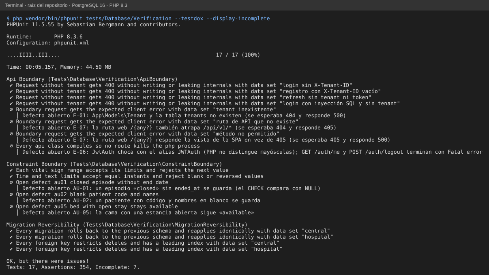
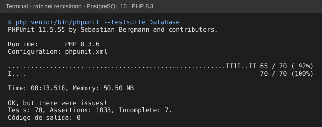

# Semana 15 — Pruebas automatizadas de restricciones, migraciones y API

**Estudiante:** Joshua Eduardo García Reyes (`jgarciar73-svg`) · **Módulo:** Verificación de base de datos PostgreSQL (asignado en el tablero del docente)

**Tarea:** pruebas automatizadas de restricciones y migraciones en `tests/Database` (caja blanca) y casos límite por API (caja negra). **Entregable:** pruebas en el repo del grupo con ejecución exitosa y casos cubiertos.

Las pruebas están en `tests/Database/Verification/` y entran en la suite del grupo (`--testsuite Database`, grupo `database-integrity`). No cambian código, migraciones ni pruebas existentes.

## 1. Casos cubiertos

| Archivo | Tipo | Caso | Cubre |
|---|---|---|---|
| `MigrationReversibilityTest` | Caja blanca | Cada migración de CENTRAL y HOSPITAL, una por una: `up` → `down` deja el esquema igual que antes (columnas, restricciones, índices, triggers y funciones) y volver a aplicarla da el mismo esquema; `migrate:reset` no deja objetos | M3 y M4 del plan SQA (semana 14); reemplaza el `--step` fijo de AU-06 |
| `MigrationReversibilityTest` | Caja blanca | Todas las FK de las dos bases son `RESTRICT`/`NO ACTION` y tienen un índice que empieza por sus columnas | Auditoría semana 7 (57 FK) |
| `ConstraintBoundaryTest` | Caja blanca | Valores límite de los 9 rangos de `vital_signs`: acepta cada límite y rechaza el valor siguiente (p. ej. temperatura 25.1 y 45 sí; 25 y 45.1 no), presión sistólica = diastólica sí, una menos no | RD de signos vitales (semana 2) |
| `ConstraintBoundaryTest` | Caja blanca | Instantes iguales (`recorded_at = measured_at`) sí, un segundo antes no; alergia resuelta el mismo día de inicio sí, un día antes no; alérgeno o reacción en blanco no | RD-03 y textos obligatorios |
| `ConstraintBoundaryTest` | Caja blanca | Defectos abiertos de la auditoría: AU-01, AU-02 y AU-05 | Semana 7 |
| `ApiBoundaryTest` | Caja negra | 4 peticiones sin `X-Tenant-ID` (login, registro con cabecera vacía, refresh y login con inyección SQL y contraseña de 10 000 caracteres): 400 con el mensaje exacto, sin SQL ni nombres de base en la respuesta y sin cambiar ninguna fila de las dos bases | Matriz de la semana 5 y catálogo de errores de la semana 8 |
| `ApiBoundaryTest` | Caja negra | Tenant inexistente → 404, ruta de API inexistente → 404, método no permitido → 405 | E-01, E-07 |
| `ApiBoundaryTest` | Caja blanca | Todas las clases de `app/` compilan (`php -l`): ninguna ruta tumba el proceso PHP | E-06 |

**Defectos abiertos:** la prueba se marca **incompleta** (∅) con el ID del defecto en vez de fallar, así la suite del grupo sigue en verde y el defecto queda visible en cada ejecución. El día que se corrige, la misma prueba pasa sola. Cualquier otro resultado distinto del esperado sí hace fallar la suite.

## 2. Ejecución

```bash
php vendor/bin/phpunit tests/Database/Verification --testdox --display-incomplete   # 17 pruebas: 10 pasan, 7 incompletas (defectos), 0 fallan
php vendor/bin/phpunit --testsuite Database                                         # 70 pruebas (53 del grupo + 17), 0 fallan, código de salida 0
```

Requisitos: los de la suite del grupo (PostgreSQL 15+ con `btree_gist`, bases `his_central_test` y `his_hospital_test`, credenciales por variables de entorno).





## 3. Defectos encontrados

| ID | Severidad | Defecto | Prueba | Corrección propuesta | Comprobado |
|---|---|---|---|---|---|
| E-06 | Alta | **Nuevo.** `JwtAuth.php` importa `Tymon\JWTAuth\Facades\JWTAuth` y declara la clase `JwtAuth`: PHP no distingue mayúsculas en nombres de clase y da *Fatal error* al cargarla. `GET /auth/me` y `POST /auth/logout` tumban el proceso | `test_every_api_class_compiles…` | `use Tymon\JWTAuth\Facades\JWTAuth as JwtToken;` | Con el cambio la prueba pasa |
| E-07 | Media | **Nuevo.** La ruta web `/{any?}` con `where('any', '.*')` también atrapa `/api/v1/*`: una ruta de API inexistente responde 405 y un método no permitido devuelve la vista de la SPA en vez de 404/405 en JSON | `test_boundary_request_gets…` | `->where('any', '^(?!api/).*')` | Con el cambio pasan las 2 |
| E-01 | Alta | Con `X-Tenant-ID` la API responde 500: no existen `App\Models\Tenant` ni la tabla `tenants` (semana 5) | `tenant inexistente` | Modelos sobre `hospitals` y `central_users` (semana 5) | Sigue abierto |
| AU-01 | Alta | Episodio `closed` sin `ended_at` se guarda | `test_open_defect_au01…` | Migración correctiva de la semana 7 | Con la correctiva pasan las 3 |
| AU-02 | Media | Código y nombres del paciente en blanco se guardan | `test_open_defect_au02…` | Ídem | Ídem |
| AU-05 | Alta | Cama `available` con una estancia abierta | `test_open_defect_au05…` | Ídem | Ídem |

## 4. Las pruebas detectan errores (mutaciones)

| Cambio hecho a propósito | Resultado |
|---|---|
| `temperature <= 45` → `< 45` | Falla el caso de límites (45 ya no se acepta) |
| `oxygen_saturation >= 0` → `>= -5` | Falla: −0.1 ya no se rechaza |
| Quitar `DROP FUNCTION preserve_h4_observation()` del `down()` | Falla la reversibilidad: queda la función |
| FK `beds.ward_id` con `ON DELETE CASCADE` | Falla la prueba de FK |
| `TenantMiddleware` responde 422 en vez de 400 | Fallan los 4 casos de caja negra |
